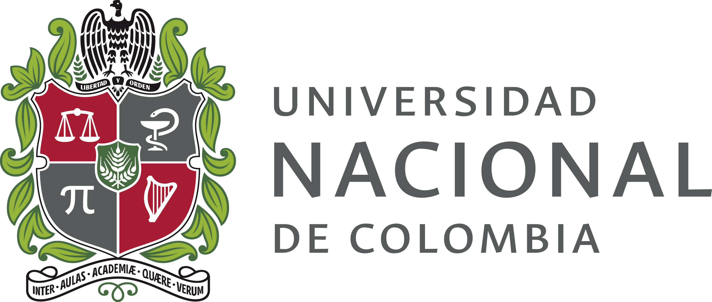

{fig-alt="Logo de la Universidad Nacional de Colombia" width="340px" fig-align="center"}

::: {.autor}
Página creada por **José Luciano Mejía Arias** con talleres para estudiar matemáticas.
:::

Bienvenido. Aquí encuentra los talleres de cada materia en el orden en que se estudian. Cada taller tiene su solucionario para que pueda revisar su trabajo.

## Materias

| # | Materia | Contenido | Talleres |
|:-:|---|---|:-:|
| 1 | [Matemáticas básicas](materias/matematicas-basicas.qmd) | Operaciones, factorización, ecuaciones, conjuntos, funciones, logaritmos y trigonometría | 6 |
| 2 | [Cálculo diferencial](materias/calculo-diferencial.qmd) | Límites, regla de L'Hôpital y reglas de derivación | 2 |
| 3 | [Cálculo integral](materias/calculo-integral.qmd) | Técnicas de integración, áreas, volúmenes y series | 4 |
| 4 | [Álgebra lineal](materias/algebra-lineal.qmd) | Sistemas de ecuaciones, matrices, inversa, determinantes y vectores | 2 |
| 5 | [Ecuaciones diferenciales](materias/ecuaciones-diferenciales.qmd) | Primer y segundo orden, modelación y transformada de Laplace | 3 |

## Cómo trabajar los talleres

1. Elija la materia y abra el taller que le asignaron.
2. Resuelva los ejercicios en su cuaderno, mostrando todo el procedimiento.
3. Solo después de intentarlo, abra el solucionario y compare sus respuestas.
4. Si tiene dudas sobre un tema, revise las explicaciones de la materia.
